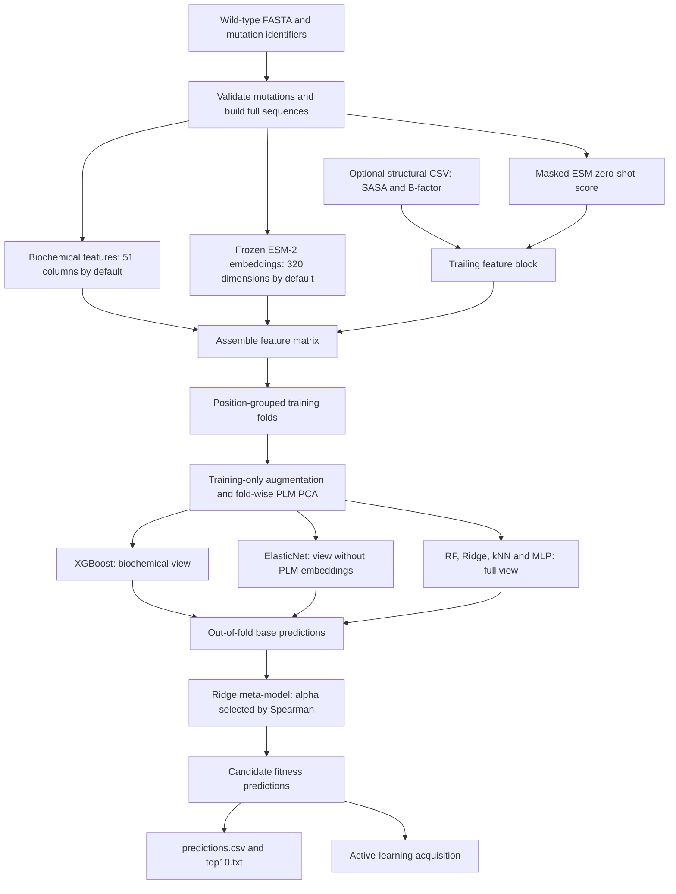
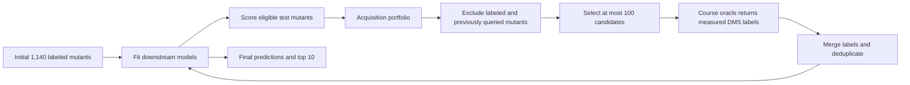
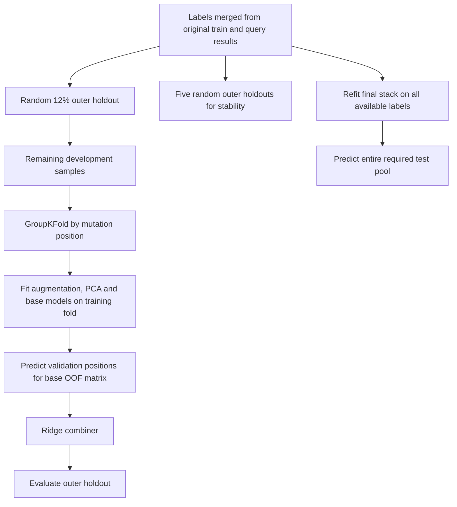

# ML-Guided Protein Engineering with Active Learning

**Team 20:** Florin Brunner, Abigail Cressy, Sofia Oliver, Chittebbayi Penugonda, and Eric Sheng.

**Rank protein mutations with limited experimental labels using frozen protein language model features, a stacked regression ensemble, and three rounds of active learning.** Team 20 · CSE 7850 / CX 4803 · ML4BIO Hackathon.

The team's report records an improvement from **~0.05 → ~0.19 → ~0.39 Spearman correlation** across development milestones. The final archive contains predictions for **11,324 candidate mutants**, a top-10 recommendation list, and **300 acquired labels**. These are historical artifacts; the external leaderboard scores have not been independently reproduced.

> **Did we fine-tune a protein model?** No. The supplied final pipeline uses pretrained protein models in evaluation mode under `torch.no_grad()` to extract fixed features. It then trains supervised regressors, a small MLP, and a stacking meta-model on DMS labels. It improves the predictor by adding selectively acquired labels and retraining those downstream models. ESM fine-tuning or LoRA is a proposed next step in the report, not an implemented result.

[Report](docs/report/Team20_Hackathon_Report.pdf) · [Task guide](docs/instructions/MLB_S26_Hackathon_Guide.pdf) · [Overview slides](docs/instructions/MLB26_Hackathon_Overview.pdf) · [Logistics](docs/instructions/Hackathon_Logistics.pdf) · [Evidence and limitations](docs/evidence.md)

## Explain the project in 60 seconds

> “Our team worked on ML-guided protein engineering: predicting which single amino acid substitutions would preserve or improve protein function when experimental measurements were scarce. We started with 1,140 labeled mutants and could request only three batches of 100 additional measurements. We used frozen ESM protein representations, biochemical features, and a stacked ensemble to predict fitness. We used position-grouped cross-validation to reduce position leakage, and active learning to balance promising candidates, model disagreement, and exploration. The report records a Spearman improvement from roughly 0.05 to 0.39. We produced predictions for every test mutant and recommended ten candidates. The main lesson was that label selection, feature routing, and validation design mattered as much as model size. We trained the downstream predictor; we did not fine-tune ESM.”

Use **“we”** for the team outcome. The report describes approximately equal contributions after an initial parallel exploration phase; it does not establish which individual authored each component. Describe your personal implementation work only where you can substantiate it.

## Objective and success criteria

Wet-lab measurements are expensive. Given one wild-type protein and a limited set of measured variants, the task was to learn a function from a **single-site amino acid substitution** to a normalized **DMS fitness score in [0, 1]**. A higher score indicates better measured function in the supplied assay.

There were two connected objectives:

1. **Rank the full candidate set accurately.** Submit a score for each of the 11,324 test mutants; Spearman correlation evaluates agreement with the hidden fitness ranking.
2. **Find useful experimental candidates.** Recommend ten test mutants with high fitness and use at most 300 new measurements to improve the predictor.

The project is regression with a ranking evaluation, rather than classification. Spearman is the correlation between the ranks of predictions and labels. Correct ordering matters even when absolute scores are imperfect. Individual base learners still optimize squared-error-style losses; selecting hyperparameters using Spearman does not turn their loss into a differentiable ranking objective.

**What was achieved?** The report's ~0.39 final correlation exceeds the task rubric's ≥0.35 highest Spearman band. That supports success on the ranking objective, subject to the report's evidence. The archive proves that a ten-mutant list was generated, but contains no official top-10 percentile score, verified placement, or new wet-lab validation. Do not claim an award, a measured improvement over wild type, or a successful engineered protein from these files alone.

## Data and experimental budget

| Artifact | Observed contents | Purpose |
|---|---:|---|
| `data/sequence.fasta` | One 656-residue wild-type sequence | Reconstruct full mutant sequences |
| `data/train.csv` | 1,140 labeled mutants | Initial supervised training |
| `data/test.csv` | 11,324 mutants without labels | Prediction and acquisition pool |
| `data/query_round_{1,2,3}.txt` | 100 unique mutants per round | Historical oracle requests |
| `data/query_round_{1,2,3}_results.csv` | 100 measured labels per round | Expand training to 1,440 unique mutants |
| `predictions.csv` | 11,324 predictions | Archived final submission |
| `top10.txt` | Ten candidate mutants | Archived recommendation list |

A mutation such as `W560F` means “replace wild-type tryptophan W at **zero-based** position 560 with phenylalanine F.” Sequence reconstruction validates the wild-type residue and bounds before making the substitution. The supplied counts total 12,464 single-site variants, matching 656 × 19 alternatives.

The test pool continues to include queried mutants, as required by the task. Acquired labels are legal training data in this active-learning setting. This evaluation differs from a test set whose labels must remain entirely inaccessible throughout development.

## Architecture



### Frozen representations and feature engineering

The default protein model is **ESM-2 8M**, `esm2_t6_8M_UR50D`. Final-layer residue representations are mean-pooled into a 320-dimensional sequence embedding. The code supports larger ESM-2 models, ESM-1v, and ProtT5, but support does not establish that those models produced the submitted result.

The default feature matrix has **372 columns before PCA**:

- **51 biochemical columns:** 20 wild-type and 20 destination amino acid indicators; normalized position; four descriptors for hydrophobicity/charge changes and source/destination hydrophobicity; five whole-sequence ProtParam properties; and one BLOSUM62 substitution score.
- **320 embedding columns:** contextual sequence information from frozen ESM-2.
- **One zero-shot column:** at the masked mutation site, `log P(mutant residue | context) − log P(wild-type residue | context)`. This is a pretrained evolutionary prior, not the supervised fitness prediction.

A structural CSV can add two columns, but none was supplied and `structure_csv=None` by default. PCA reduces the PLM block to at most 128 components, limited by training sample count. Feature routing lets different models use different views of the same assembled matrix.

### Why use an ensemble with so few labels?

| Base learner | Actual feature view | Reason to include it |
|---|---|---|
| XGBoost | Traditional biochemical block | Nonlinear interactions in compact features |
| Random forest | Full feature matrix | Nonlinear partitioning and model diversity |
| Ridge | Full feature matrix | Regularized linear baseline |
| ElasticNetCV | Traditional + trailing blocks, excluding embeddings | Sparse/regularized compact baseline |
| k-nearest neighbors | Full feature matrix | Local similarity baseline |
| MLP | Full feature matrix | Small learned nonlinear regressor |

All six are enabled in the final `Config`. PCA and scaling are part of the fitting paths. The code can fall back to scikit-learn's `HistGradientBoostingRegressor` if XGBoost is unavailable, so record the actual backend when reproducing a run.

The MLP is trained from scratch: **input → 256/ReLU/dropout(0.2) → 256/ReLU/dropout(0.2) → scalar**, with MSE, AdamW, a default learning rate of 0.001, weight decay 0.0001, and early stopping. Training this MLP does not update the protein model.

### What stacking learns

Each base learner predicts validation samples that were excluded from its own fit. Those out-of-fold predictions form a matrix with one column per base model. A Ridge meta-model learns how to combine them. Its regularization strength is selected from 24 log-spaced values using mean inner-CV Spearman; the fitted Ridge still minimizes a regularized squared-error objective.

At inference, fitted base models produce the same six-column prediction representation for each candidate, and the fitted meta-model combines it. This avoids fitting the combiner solely on overoptimistic in-sample base predictions. The implementation has additional validation caveats described below.

## Active learning: deciding which labels to buy



The oracle represents an experimental labeling budget; the repository does not execute new laboratory experiments or call a live oracle. Historical measurements are already included.

| Round | Strategy in the final code/report | Query mean DMS | Median DMS | Distinct positions |
|---|---|---:|---:|---:|
| 1 | 50/50 normalized predicted fitness and distance to nearest labeled embedding | 0.7780 | 0.8410 | 51 |
| 2 | 28% UCB/EI, 28% greedy, 24% hybrid, 20% random; substitution-error steering | 0.8013 | 0.8511 | 61 |
| 3 | Neighborhood prefill around top candidates, then greedy/UCB/hybrid/random; destination caps/floors | 0.8261 | 0.8554 | 49 |

These means are recomputed from the archived labels. They describe **the selected batches**, not improvement in the protein's fitness or a controlled active-learning benchmark. There is no matched random-acquisition ablation establishing the causal benefit of the portfolio.

The acquisition functions have complementary purposes:

- **Greedy:** prioritize high predicted fitness for exploitation.
- **Hybrid:** combine normalized predicted fitness with distance to the nearest labeled example for exploration. `hybrid_alpha` weights distance; it is 0.5 in round 1.
- **UCB:** predicted mean plus `beta × disagreement`, where disagreement is the standard deviation across base predictions.
- **Expected improvement:** a Gaussian approximation using the same mean/disagreement and the best measured fitness.
- **Random:** maintain some coverage beyond the model's current preferences.

Disagreement is a heuristic uncertainty proxy, not a calibrated posterior standard deviation. UCB/EI therefore provide acquisition heuristics rather than formal Bayesian guarantees.

The code blocks both previously measured mutants and archived requests. Diversity penalties reduce near-duplicate selections; destination amino acid floors/caps help balance substitution types. Round 3 disables round-2 diagnostic weighting to concentrate attention on the high-prediction tail.

**Round-3 implementation detail:** defaults prefill five neighbors, then allocate nominal budgets of 35 greedy, 28 UCB, 22 hybrid, and 15 random. The total is capped at 100, so with a full prefill only ten random slots remain before destination balancing. Nominal budgets should not be presented as an exact 100-point final allocation.

## Results and how to interpret them

### Reported external development milestones

| Milestone | Approximate Spearman | Changes associated with that stage in the report |
|---|---:|---|
| Baseline checkpoint | 0.05 | Naive predictor |
| After round 1 | 0.19 | PLM features and initial active learning |
| After round 2 / reported final result | 0.39 | Stacking, fold-wise PCA, and portfolio querying |

The absolute reported gain is **~0.34 Spearman**. Multiple changes were introduced together; the report does not isolate how much each change contributed. It also does not provide a distinct post-round-3 leaderboard score. The PDFs are the source for this trajectory; no original leaderboard export is included.


### Saved local evaluation from the submitted notebook

| Model | One saved 12% holdout | Mean across five holdouts |
|---|---:|---:|
| Stack | 0.6585 | **0.7072 ± 0.0537** |
| Random forest | **0.6771** | 0.7069 |
| XGBoost | 0.6369 | 0.6866 |
| MLP | 0.5047 | 0.5311 |
| Ridge | 0.4352 | 0.4850 |
| ElasticNet | 0.4018 | 0.4590 |
| kNN | 0.3372 | 0.4337 |

Values come from outputs saved in the supplied notebook, preserved as [structured metrics](results/saved_notebook_metrics.json). They were not regenerated while preparing this repo. The ± value is the saved standard deviation across five splits, not a confidence interval.

**The stack did not decisively beat random forest locally:** its repeated-holdout mean advantage is only about 0.0002, and it loses on the single saved holdout. An honest interview account should acknowledge that added ensemble complexity was not strongly justified by this local comparison.

Do not compare the local ~0.707 score directly with the external ~0.39 score. They use different evaluation populations and protocols; the archive cannot establish the precise reason for the gap.

### Archived top-10 recommendations

`W560F`, `W590F`, `W582Y`, `W590Y`, `W560Y`, `T572S`, `T572V`, `I611V`, `Y598F`, `T606S`.

These are model recommendations. The provided files do not establish their final global percentile ranks or measured improvement relative to wild type.

## Validation, regularization, and limitations

The key generalization problem is predicting mutations at new residue positions. Randomly splitting substitutions can place different mutations at the same position in both training and validation, making position memorization look like generalization.



**Implemented safeguards:** position-grouped base OOF folds; PLM PCA fit within training folds; regularized linear learners; MLP dropout and early stopping; embedding noise; upper-tail augmentation; query deduplication; and repeated holdout evaluation.

**Practical limits to describe accurately:**

- **Outer holdouts are random by mutant, not grouped by position.** LPO is used inside stacking, so local holdout scores are not a strict unseen-position benchmark.
- **Saved holdout membership is conditional.** It is reused only while the sample count and ordered mutant hash match; adding query labels can regenerate it. It is not an immutable test set across acquisition rounds.
- **Meta-selection is not fully nested/grouped.** The Ridge alpha search uses shuffled KFold and scales its OOF matrix before its inner splits. A stricter design would fit scaling per inner fold and group by position. Meta OOF diagnostics reuse a shared base OOF matrix rather than rebuilding the whole stack inside each outer diagnostic fold.
- **MLP early stopping observes the base validation fold's labels.** Its OOF values are therefore not fully independent of those labels for model selection. An inner early-stopping split would give cleaner estimates.
- **Optional Optuna tuning runs before the outer holdout split in this pipeline.** Enabling it would compromise that holdout as an untouched evaluation. It is disabled in the supplied notebook; tune only within development folds in a revised experiment.
- **“SMOTE” has a fallback.** The code attempts `imblearn.over_sampling.SMOTER`; if unavailable, it duplicates high-fitness training samples with Gaussian feature noise. The default enabled flag is not proof that interpolation-based SMOTE actually ran.
- **No controlled ablation or independent leaderboard record is included.** Reported stages support a development narrative, not causal attribution to each feature or model.
- **Dependencies are unpinned and weights/caches are absent.** Results may vary with library versions, backend, and hardware. Exact historical reproduction is not guaranteed.

These issues are reasons to improve the experimental design and calibrate claims. They do not change the archived artifacts or the report's stated results.

## Run the project

Use Python 3.11–3.13 as a practical starting point; the original archive does not specify an exact environment. This repo retains the team's `pipeline.py` implementation. The notebook's saved outputs were cleared for readability; historical metrics are stored separately.

```bash
python3 -m venv .venv
source .venv/bin/activate
python -m pip install -r requirements.txt
python scripts/audit_artifacts.py
jupyter lab pipeline.ipynb
```

Run notebook cells from the repository root. The notebook installs dependencies, creates `Config`, trains and evaluates the stack, then exports `predictions.csv` and `top10.txt`. Those two root files are already the historical submission; copy them elsewhere before running if you want to compare them with a new run. First execution downloads pretrained ESM weights and computes embeddings for full 656-residue sequences; repeated evaluation makes a full run substantially more expensive than the artifact audit. The device selector uses CUDA, then Apple MPS, then CPU.

For the same workflow from Python:

```python
from pathlib import Path
from pipeline import Config, run_pipeline, export_submission_files

root = Path.cwd()
cfg = Config(
    data_dir=root / "data",
    cache_dir=root / "cache",
    holdout_index_path=root / "cache" / "holdout_indices.npy",
)
results = run_pipeline(cfg, run_optuna=False)
print(results.holdout_spearman)
print(results.repeated_holdout)
print(export_submission_files(results))
```

All three query-result files are loaded by default. This reproduces the **final available training set**, not the chronological round-1 model. To replay acquisition history, use a separate data directory containing only labels and archived requests available at that point. `export_query_file(results, "round1")` writes a local query file; it neither requests labels nor submits anything. With the final directory, all three historical batches are already blocked.

Optional structural input requires `mutant`, exactly one SASA-like numeric column, and exactly one B-factor-like numeric column. Missing mutants receive zero structural values. Optuna is opt-in through `run_pipeline(cfg, run_optuna=True)`; address the holdout ordering issue above before interpreting tuned evaluation scores.

**Lightweight verification without ML dependencies:**

```bash
python3 scripts/audit_artifacts.py
python3 -m compileall -q pipeline.py scripts
```

The audit uses only Python's standard library. It checks sequence consistency, unique mutations, query exclusions, prediction coverage/range, top-10 membership/order, and recomputes round statistics. It does not retrain the model or verify hidden test performance. CI runs these same checks.

## Repository map

```text
.
├── pipeline.py                 # Original final team implementation
├── pipeline.ipynb              # Original notebook, outputs cleared
├── requirements.txt            # Team dependencies + notebook runner
├── data/                       # Original inputs, query requests and returned labels
├── predictions.csv             # Historical 11,324-row prediction submission
├── top10.txt                    # Historical candidate recommendation submission
├── GroupName.txt               # Non-secret team number
├── results/
│   └── saved_notebook_metrics.json
├── scripts/audit_artifacts.py   # Dependency-free artifact verification
├── docs/
│   ├── report/                 # Original team report
│   ├── instructions/           # Course guide, slides and logistics
│   ├── evidence.md             # Provenance and report/code discrepancies
│   ├── original-README.md      # Team's original run instructions
│   └── source-manifest.json    # Source filenames and SHA-256 hashes
└── .github/workflows/verify.yml
```

The final team archive is the implementation source. An older downloaded `cse_7850_hackathon-main.zip` contains a separate modular codebase, including a fine-tuning module; it was not merged into this final implementation because that would imply unsupported methods and obscure what the report describes. An unrelated `Team20.pdf` microbiome project is also excluded.

`APIKey.txt` is deliberately excluded and ignored. No oracle credential is needed to read the project, inspect saved artifacts, or retrain on the provided labels. The original course materials and team work retain their existing ownership; no new redistribution license is asserted.

## ML interview discussion

**Why frozen ESM instead of fine-tuning?** We had 1,140 initial labels and at most 300 more. Fixed pretrained representations transfer sequence context while keeping supervised fitting smaller and cheaper. Fine-tuning ESM would add many parameters and increase overfitting/compute risk. LoRA would be an experiment to compare under the same grouped evaluation, not something this project already did.

**What actually changed during learning?** The labeled dataset grew after each acquisition. Downstream regressors and the combiner were refit; pretrained ESM weights stayed fixed. Hyperparameter tuning changes choices such as tree depth or regularization, not the pretrained representation's weights.

**How did you avoid leakage?** We grouped base OOF folds by residue position and fit PCA on training folds. The final code still uses random outer holdouts and has meta-selection/MLP early-stopping caveats, so I would not describe it as a fully leakage-free benchmark. I would move all selection inside nested position-grouped splits for a stronger follow-up.

**Why Spearman if models train with MSE?** The experimental decision is which mutants to test. Spearman matches ordering quality; MSE is a convenient fitting objective. We selected meta regularization and optional model hyperparameters using rank correlation. Pairwise ranking losses would be a further experiment.

**Did active learning help?** Reported model performance improved while new labels and architecture changes were added, and measured batch means increased from 0.778 to 0.826. To isolate acquisition value, I would compare against multiple seeded random-query runs with identical model architecture and label budgets.

**Was stacking worth it?** Locally its mean was essentially tied with random forest. I would evaluate whether the slight difference survives repeated position-grouped splits and prefer the simpler model if it does not. Ensemble disagreement can still be useful for acquisition, provided it is validated as an uncertainty signal.

**What would you improve next?** Start with strict nested position-grouped evaluation and a random-acquisition baseline. Then ablate biochemical features, zero-shot scores, PLM embeddings, and individual learners. Measure top-tail ranking quality alongside Spearman, assess uncertainty calibration, and compare frozen ESM against parameter-efficient tuning under equal budgets.

**What is the defensible outcome?** “Our team produced a working active-learning protein fitness ranking pipeline, used 300 acquired labels, and reported a final Spearman of about 0.39 versus a roughly 0.05 baseline.” Keep local holdout scores, external reported scores, and experimentally validated biological claims separate.
