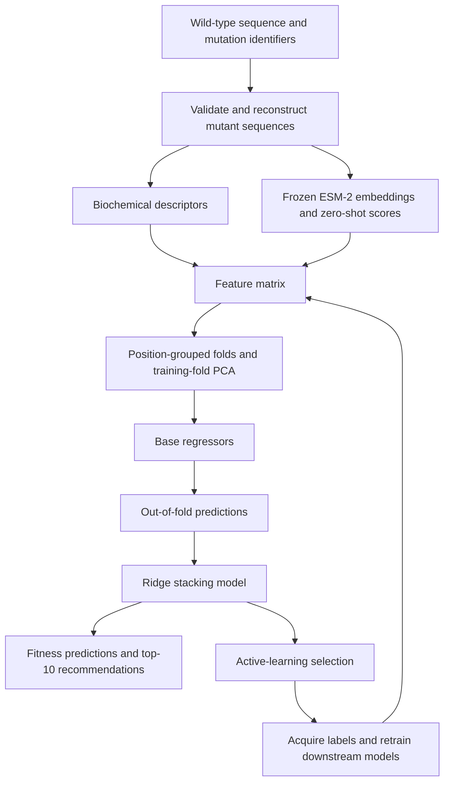

# ML-Guided Protein Engineering with Active Learning

**Team 20:** Florin Brunner, Abigail Cressy, Sofia Oliver, Chittebbayi Penugonda, and Eric Sheng.

CSE 7850 / CX 4803 · ML4BIO Hackathon

Predict the fitness of single amino acid substitutions and recommend high-performing mutants using limited experimental labels. The pipeline combines frozen ESM-2 representations, biochemical features, stacked regression, and three rounds of active learning. The team report records Spearman correlation improving from **~0.05 to ~0.39**.

[Project report](docs/report/Team20_Hackathon_Report.pdf) · [Task guide](docs/instructions/MLB_S26_Hackathon_Guide.pdf) · [Implementation notes](docs/evidence.md)

## Objective and data

The task is to predict normalized Deep Mutational Scanning (DMS) scores in [0, 1], rank **11,324 candidate mutants**, and recommend the top ten. Spearman correlation measures agreement with the measured fitness ranking.

The dataset contains one **656-residue protein**, **1,140 initially labeled mutants**, and **300 additional measurements** acquired in three batches of 100. Merging these measurements produces 1,440 unique training examples. Mutation identifiers use zero-based positions: `W560F` replaces tryptophan at position 560 with phenylalanine.

## Technical implementation



### Feature extraction

The default representation has **372 columns before PCA**:

- **51 biochemical features:** amino acid identities, normalized position, hydrophobicity and charge descriptors, five ProtParam properties, and BLOSUM62 substitution scores.
- **320 ESM-2 features:** mean-pooled final-layer embeddings from `esm2_t6_8M_UR50D`.
- **One zero-shot score:** the masked-site log-probability difference between mutant and wild-type residues.

ESM runs in evaluation mode under `torch.no_grad()`. **The protein model is frozen; no ESM fine-tuning or LoRA is performed.** Supervised training updates the downstream models. Embeddings are cached, and PCA reduces the embedding block to at most 128 components within training folds. Optional structural input adds SASA and B-factor features; none is included in the default run.

### Regression and stacking

| Model | Feature view |
|---|---|
| XGBoost | Biochemical features |
| ElasticNetCV | Biochemical and trailing features, excluding embeddings |
| Random forest, Ridge, kNN, MLP | Full feature matrix |

Base models generate out-of-fold predictions using `GroupKFold` grouped by mutation position. A Ridge meta-model combines these predictions; its regularization strength is selected using cross-validation Spearman correlation. Base learners use squared-error-style objectives.

The MLP has two 256-unit hidden layers with ReLU and 0.2 dropout, trained with MSE, AdamW, and early stopping. Additional regularization includes embedding noise and upper-tail augmentation. The augmentation code attempts `SMOTER` and falls back to duplicating high-fitness samples with Gaussian feature noise.

### Active learning

| Round | Acquisition strategy | Measured batch mean DMS |
|---|---|---:|
| 1 | Equal weighting of predicted fitness and distance from labeled embeddings | 0.7780 |
| 2 | Portfolio: 28% UCB/EI, 28% greedy, 24% hybrid, 20% random | 0.8013 |
| 3 | Top-candidate neighborhood prefill, followed by greedy/UCB/hybrid/random selection | 0.8261 |

UCB and expected improvement use disagreement across base models as an uncertainty proxy. Query selection excludes labeled and previously queried mutants, applies diversity penalties, and supports destination amino acid caps and floors. Each round is capped at 100 queries; returned labels are merged before retraining. The repository includes the historical query requests and measurements.

Batch means describe selected candidates, not measured improvement over wild type. Architecture and acquisition changes were introduced together, so their individual contributions were not isolated.

## Results

| Development stage | Reported external Spearman |
|---|---:|
| Baseline | ~0.05 |
| After initial PLM integration and querying | ~0.19 |
| Stacking, PCA, and portfolio acquisition | ~0.39 |

The reported gain is **~0.34 Spearman**. Saved notebook outputs separately record a local stack mean of **0.7072 ± 0.0537** across five random holdouts, nearly tied with random forest at **0.7069**. Local and external scores use different evaluation protocols and are not directly comparable. Historical metrics are preserved in [results/saved_notebook_metrics.json](results/saved_notebook_metrics.json); full training has not been rerun during repository preparation.

The submission contains predictions for all 11,324 test mutants and ten recommendations. Official top-10 percentile results and independent wet-lab validation are not included.

**Evaluation limitations:** base OOF folds are position-grouped, but outer holdouts and the meta-model's inner alpha search are random by sample. MLP early stopping uses base validation labels. Optional Optuna tuning is disabled in the supplied notebook and would require restructuring to preserve an untouched outer holdout. Dependencies are unpinned. Further details are documented in [implementation notes](docs/evidence.md).

## Setup and execution

Use Python 3.11–3.13 from the repository root:

```bash
python3 -m venv .venv
source .venv/bin/activate
python -m pip install -r requirements.txt
jupyter lab notebooks/pipeline.ipynb
```

Run all notebook cells to load the original data and all three query-result files, extract features, train and evaluate the stack, and export `predictions.csv` and `top10.txt` into `results/generated/`. Historical submissions remain in `results/submissions/`. Initial execution downloads pretrained weights; embeddings are cached locally. Device selection uses CUDA, then Apple MPS, then CPU.

To verify the included artifacts without installing ML dependencies:

```bash
python3 scripts/audit_artifacts.py
```

The audit checks mutation sequences, query uniqueness, prediction coverage and bounds, and top-10 consistency. GitHub Actions also runs this audit and compiles the Python sources.

## Repository structure

```text
├── src/pipeline.py             # Feature extraction, training, and acquisition
├── notebooks/pipeline.ipynb    # End-to-end workflow
├── data/                       # Sequences, labels, and historical queries
├── results/
│   ├── submissions/            # Historical predictions, top 10, and team ID
│   └── saved_notebook_metrics.json
├── docs/
│   ├── report/                 # Team report
│   ├── instructions/           # Course materials
│   ├── archive/                # Original run instructions
│   └── evidence.md             # Provenance and evaluation limitations
├── scripts/audit_artifacts.py  # Artifact validation
├── .github/workflows/verify.yml
├── requirements.txt
└── README.md
```

New runs write to the ignored `results/generated/` directory by default; `Config.output_dir` can override this location. Model weights and embedding caches remain outside version control.

Oracle credentials are excluded. No API key is needed to train with the included measurements. Original course materials and team work retain their existing ownership.
